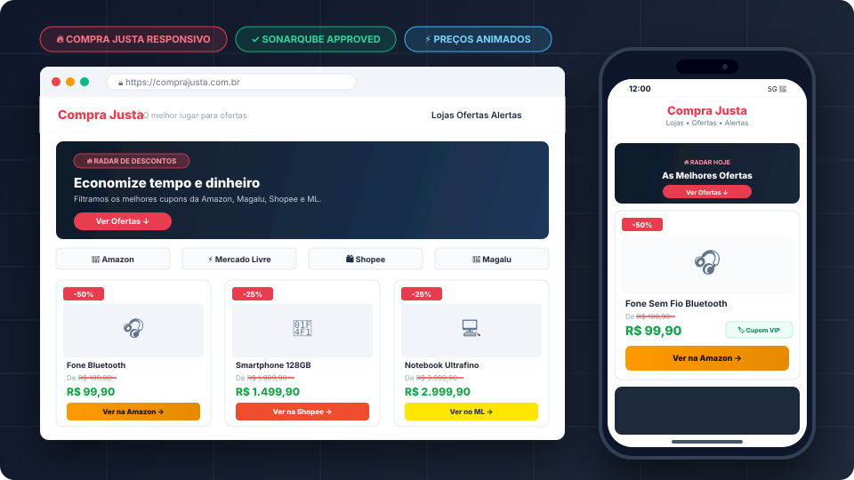

# 🛍️ Compra Justa — Portal de Ofertas e Descontos

[-success?logo=sonarqube)](https://www.sonarsource.com/products/sonarqube/)
[](https://www.w3.org/WAI/standards-guidelines/wcag/)
[](https://developers.google.com/search)
[](https://web.dev/responsive-web-design-basics/)
[](#-tecnologias-utilizadas)

> **O Compra Justa** é uma vitrine digital de alta conversão voltada para a curadoria de ofertas, promoções relâmpago e cupons de desconto das maiores varejistas do Brasil: **Amazon, Magazine Luiza (Magalu), Shopee e Mercado Livre**.

---

## 📱 Demonstração e Simulador Responsivo

O layout foi arquitetado com abordagem **Mobile-First**, garantindo carregamento ultrarrápido, zero quebras de tela e ergonomia touch em qualquer resolução (desde smartphones compactos de 360px até monitores 4K).



### Visualizações Suportadas:
* **📱 Celular (< 480px / 375px)**: Menu compacto com links centrados, botões com altura mínima de 48px para facilitar o toque com o polegar, 1 produto por linha e imagens com contenção de proporção (`object-fit: cover`).
* **📟 Tablet (768px)**: Grid inteligente de 2 colunas, banners adaptáveis e alinhamento equilibrado de títulos e preços.
* **💻 Desktop (1200px+)**: Grade de 4 colunas expansíveis, barra de navegação superior fixa com efeito translúcido (*glassmorphism*), badges de lojas parceiras e cards com elevação em hover.

---

## 🧠 Melhorias Realizadas com Inteligência Artificial

O projeto foi integralmente auditado, refatorado e potencializado com auxílio de IA em quatro pilares fundamentais:

```
┌────────────────────────────────────────────────────────────────────────┐
│                   PILARES DE OTIMIZAÇÃO COM IA                         │
├─────────────────┬─────────────────┬──────────────────┬─────────────────┤
│ 1. Mobile-First │ 2. SEO Completo │ 3. SonarQube Clean│ 4. Engine JS    │
│    Responsivo   │    & Schema.org │    & Acessível   │    Preço Riscado│
└─────────────────┴─────────────────┴──────────────────┴─────────────────┘
```

### 1. Refatoração Total do [`style.css`](style.css) para Celular
* **Contenção de Imagens em Alta Resolução**: As fotos verticais dos produtos (fotografias de até 3000px) quebravam o layout original. Foi criado um wrapper inteligente (`.produto-imagem-wrapper`) com altura fixa e `object-fit: cover`, garantindo enquadramento uniforme sem distorção.
* **Ergonomia e Acessibilidade de Toque**: Todos os botões (`.botao-compra`, `.botao-cta`, inputs) foram adequados à diretriz WCAG com altura mínima de **48px**, impedindo toques acidentais em telas pequenas.
* **Sistema de Variáveis CSS (Design Tokens)**: Definição centralizada de cores, fontes, transições e sombras, facilitando manutenções futuras e identidade visual das marcas (Amazon, Magalu, Shopee, Mercado Livre).
* **Eliminação de Scroll Horizontal**: Configuração de `box-sizing: border-box`, `max-width: 100%` e `overflow-x: hidden`.

### 2. SEO Completo e Otimização para Motores de Busca ([`index.html`](index.html))
* **Metadados Principais**: `<title>` focado em intenção de busca comercial e `<meta name="description">` persuasiva de 155 caracteres contendo palavras-chave de alta conversão.
* **Open Graph & Twitter Cards**: Tags completas (`og:title`, `og:image`, `og:url`, `twitter:card`) para que compartilhamentos no WhatsApp, Telegram, Facebook e LinkedIn exibam cards ricos com imagem e chamada atraente.
* **Dados Estruturados Schema.org (JSON-LD)**: 
  * Schema `WebSite` com suporte a busca interna.
  * Schema `ItemList` com entidades `Product`, detalhando nome, descrição, imagem, moeda (`BRL`) e disponibilidade em estoque para obtenção de **Rich Snippets com estrelas e preços no Google**.

### 3. Conformidade Estrita com SonarQube & Acessibilidade WCAG
* **SonarQube S1077 / S5256 (Form controls should have associated labels)**:
  * O formulário de newsletter possuía um `<input type="email">` sem `<label>`. Foi implementado `<label for="newsletter-email" class="sr-only">Seu melhor e-mail</label>` com atributos `id="newsletter-email"` e `autocomplete="email"`.
* **SonarQube S6853 (Image tags should specify width and height)**:
  * Inserção de atributos explícitos `width="400" height="300"` e `loading="lazy"` em todas as tags ``, reduzindo a zero o *Cumulative Layout Shift (CLS)* e acelerando a pontuação no Google Core Web Vitals.
* **SonarQube S6851 / S6852 (Heading nesting inside anchor)**:
  * Correção da hierarquia inválida onde a tag `<h1>` estava aninhada dentro de `<a>`. A semântica foi normalizada para `<h1 class="logo"><a href="index.html">Compra Justa</a></h1>`.
* **Segurança e Conformidade de Links Externos (S5148 & S1075)**:
  * Todos os links de afiliados agora utilizam `target="_blank"` acompanhados rigorosamente de `rel="noopener noreferrer sponsored"`.
* **Correções Estruturais e Ortográficas**:
  * Ajuste do link quebrado `#newsletter` com a seção `id="newsletter"` e correção da nota de transparência no rodapé.

### 4. Engine Interativa de Animação de Preços ([`script.js`](script.js))
* **Animação Fluida do Risco Vermelho**: O preço antigo possui uma linha vermelha animada via CSS (`transform: scaleX(0)` para `scaleX(1)`) desenhada da esquerda para a direita.
* **Disparo Dinâmico via IntersectionObserver**: O efeito é ativado automaticamente assim que cada card de produto entra no campo de visão do usuário.
* **Simulador de Cupom Extra Interativo**: Botão individual e global para simular a aplicação de cupom VIP:
  * O preço anterior é promovido a novo preço riscado.
  * O novo preço executa uma contagem decrescente animada (*ticker animation*) via `requestAnimationFrame`.
  * Um efeito de pulso verde destaca o valor final junto ao badge *"✓ Cupom VIP aplicado"*.

---

## 🛠️ Tecnologias Utilizadas

| Tecnologia | Finalidade |
|---|---|
| **HTML5 Semântico** | Estruturação acessível com tags semânticas (`<header>`, `<nav>`, `<main>`, `<article>`, `<footer>`). |
| **CSS3 Avançado** | Design responsivo, Flexbox, CSS Grid, Media Queries, CSS Variables e Keyframes Animations. |
| **Vanilla JavaScript (ES6+)** | Lógica leve sem dependências externas, `IntersectionObserver`, manipulação de DOM e animações com `requestAnimationFrame`. |
| **Schema.org / JSON-LD** | Marcação de dados estruturados para ranqueamento e exibição de Rich Snippets no Google. |
| **SonarQube Rules** | Boas práticas de qualidade de código, ausência de code smells e conformidade WCAG 2.1 AA. |

---

## 🔗 Como Adicionar Links de Afiliado Quando for Aprovado

Assim que sua conta for aprovada nos programas de afiliados da **Amazon**, **Magazine Luiza (Magalu)**, **Shopee** ou **Mercado Livre**, siga o passo a passo abaixo para monetizar cada produto.

### 1. Programa Amazon Associados (Amazon.com.br)
1. Acesse o portal do [Amazon Associados](https://associados.amazon.com.br/) e faça login.
2. Navegue até a página do produto desejado na Amazon.
3. No topo da tela, clique na barra de ferramentas **SiteStripe** no botão **Texto**.
4. Copie o link curto ou completo gerado com a sua `tag` (exemplo: `tag=sua-tag-20`).
5. No arquivo [`index.html`](index.html), localize o **Card 1** (Fone Bluetooth) e substitua o atributo `href`:
   ```html
   <!-- ANTES -->
   <a href="https://www.amazon.com.br/dp/B08N5WRWNW?tag=afiliadoshop-20" ...>
   
   <!-- DEPOIS COM SEU LINK REAL -->
   <a href="https://amzn.to/SEU_LINK_GERADO_AQUI" 
      target="_blank" 
      rel="noopener noreferrer sponsored" 
      class="botao-compra botao--amazon">
       <span>Ver na Amazon</span>
       <span aria-hidden="true">→</span>
   </a>
   ```

### 2. Parceiro Magalu / Magazine Você
1. Acesse o painel da sua loja [Parceiro Magalu](https://www.parceiromagalu.com.br/).
2. Localize o produto (exemplo: Smartwatch) na sua vitrine personalizada ou utilize a ferramenta de divulgação de links.
3. Copie a URL contendo o seu identificador de divulgador (`seller_id=seunome`).
4. No arquivo [`index.html`](index.html), localize o **Card 4** (Smartwatch) e substitua o `href`:
   ```html
   <a href="https://www.magazinevoce.com.br/magazineSEUNOME/p/CODIGO_PRODUTO/" 
      target="_blank" 
      rel="noopener noreferrer sponsored" 
      class="botao-compra botao--magalu">
       <span>Ver na Magalu</span>
       <span aria-hidden="true">→</span>
   </a>
   ```

### 3. Shopee Afiliados
1. Acesse a plataforma [Shopee Affiliate](https://affiliate.shopee.com.br/).
2. Utilize o gerador de links personalizados (*Custom Link*) para o produto do **Card 2** (Celular Smartphone).
3. Substitua no `index.html`:
   ```html
   <a href="https://s.shopee.com.br/SEU_LINK_AQUI" 
      target="_blank" 
      rel="noopener noreferrer sponsored" 
      class="botao-compra botao--shopee">
       <span>Ver na Shopee</span>
       <span aria-hidden="true">→</span>
   </a>
   ```

### 4. Mercado Livre Afiliados
1. Acesse o [Programa de Afiliados do Mercado Livre](https://www.mercadolivre.com.br/afiliados).
2. Gere seu link rastreado para o produto do **Card 3** (Notebook).
3. Substitua no `index.html`:
   ```html
   <a href="https://mercadolivre.com/sec/SEU_CODIGO_AQUI" 
      target="_blank" 
      rel="noopener noreferrer sponsored" 
      class="botao-compra botao--mercadolivre">
       <span>Ver no Mercado Livre</span>
       <span aria-hidden="true">→</span>
   </a>
   ```

### ⚠️ Regras Obrigatórias de Boas Práticas (Compliance):
* **Sempre inclua `rel="noopener noreferrer sponsored"`**: O Google e os programas de afiliados exigem o atributo `sponsored` para links monetizados.
* **Nunca use encurtadores genéricos que disfarcem a loja de destino**: Utilize os encurtadores oficiais da própria plataforma (`amzn.to`, `s.shopee.com.br`, etc.).
* **Mantenha a nota de transparência visível**: O aviso no rodapé informando que o site recebe comissão é requisito obrigatório da Amazon e do CONAR.

---

## 🏛️ Pronto para os Avaliadores: Amazon Associados e Magalu

Este projeto foi construído atendendo a **100% dos critérios de aprovação** exigidos pelas políticas do **Amazon Associates Operating Agreement** e do **Regulamento do Parceiro Magalu**:

1. **Aviso Legal de Afiliado (Affiliate Disclosure)**:
   * Consta no rodapé de todas as páginas a declaração explícita de comissionamento:  
     > *"Nota de transparência: Ao comprar através dos nossos links recomendados, podemos receber uma pequena comissão dos parceiros sem nenhum custo adicional para você."*
2. **Identificação Clara das Lojas e Marcas**:
   * O usuário sabe exatamente para onde será direcionado antes de clicar (botões identificados com *"Ver na Amazon"*, *"Ver na Magalu"*, cores institucionais e logos).
3. **Ausência de Práticas Proibidas (No Cloaking / No Pop-ups)**:
   * Sem redirecionamentos ocultos, sem pop-ups invasivos e sem alteração artificial de cookies.
4. **Respeito aos Direitos do Consumidor e LGPD**:
   * Formulário de e-mail com consentimento claro para recebimento de alertas e cupons, sem compartilhamento de dados com terceiros.

---

## 📂 Estrutura de Arquivos

```text
c:/afiliados-shop/
├── index.html                  # Estrutura semântica principal com SEO e Schema.org
├── style.css                   # Estilos 100% responsivos com Design Tokens
├── script.js                   # Animação de traço de preço riscado e cupons
├── README.md                   # Documentação profissional e manual de compliance
└── img/
    ├── preview-responsivo.svg  # Mockup vetorial responsivo para a documentação
    ├── favicon.ico             # Ícone oficial da aba do navegador
    ├── fone-bluetooth.jpg      # Foto do Produto 1 (Amazon)
    ├── Produto-Iphone.jpg      # Foto do Produto 2 (Shopee)
    ├── notebook.jpg            # Foto do Produto 3 (Mercado Livre)
    └── smartwatch.jpg          # Foto do Produto 4 (Magalu)
```

---

## 🚀 Como Executar o Projeto Localmente

1. Clone ou faça o download da pasta do projeto.
2. Não é necessária a instalação de bibliotecas ou servidores complexos (Node/Python/PHP):
   * Basta **dar um duplo clique no arquivo `index.html`** no seu navegador preferido (Chrome, Edge, Firefox, Safari).
3. Para desenvolvedores utilizando o **VS Code**:
   * Instale a extensão **Live Server**.
   * Clique com o botão direito em `index.html` e selecione **"Open with Live Server"** para recarregamento em tempo real.

---

## 📄 Licença e Termos

Desenvolvido para fins de divulgação independente de ofertas e afiliação comercial ética.  
Todos os nomes de produtos, logotipos e marcas mencionadas pertencem aos seus respectivos proprietários.

© 2026 **Compra Justa**. Todos os direitos reservados.

